# The Complete Guide to UML (Unified Modeling Language)
### From Basics to Advanced — Concepts, Notation, Relationships, and Java Examples

---

## Table of Contents

1. [Introduction to UML](#1-introduction-to-uml)
2. [Why Use UML?](#2-why-use-uml)
3. [Types of UML Diagrams](#3-types-of-uml-diagrams)
4. [Class Diagram Basics](#4-class-diagram-basics)
5. [Relationships in UML (Core Concepts)](#5-relationships-in-uml-core-concepts)
   - [5.1 Association](#51-association)
   - [5.2 Aggregation](#52-aggregation)
   - [5.3 Composition](#53-composition)
   - [5.4 Inheritance (Generalization)](#54-inheritance-generalization)
   - [5.5 Realization (Implementation)](#55-realization-implementation)
   - [5.6 Dependency](#56-dependency)
   - [5.7 Multiplicity](#57-multiplicity)
6. [Comparison Table: Relationships](#6-comparison-table-relationships)
7. [Behavioral Diagrams](#7-behavioral-diagrams)
   - [7.1 Use Case Diagram](#71-use-case-diagram)
   - [7.2 Sequence Diagram](#72-sequence-diagram)
   - [7.3 Activity Diagram](#73-activity-diagram)
   - [7.4 State Machine Diagram](#74-state-machine-diagram)
8. [Advanced Structural Diagrams](#8-advanced-structural-diagrams)
   - [8.1 Component Diagram](#81-component-diagram)
   - [8.2 Deployment Diagram](#82-deployment-diagram)
   - [8.3 Package Diagram](#83-package-diagram)
   - [8.4 Object Diagram](#84-object-diagram)
9. [Visibility & Access Modifiers Notation](#9-visibility--access-modifiers-notation)
10. [Full Worked Example: Java + UML Class Diagram](#10-full-worked-example-java--uml-class-diagram)
11. [UML Across Other Languages](#11-uml-across-other-languages)
12. [Advanced Concepts](#12-advanced-concepts)
13. [Best Practices](#13-best-practices)
14. [Quick Reference Cheat Sheet](#14-quick-reference-cheat-sheet)

---

## 1. Introduction to UML

**UML (Unified Modeling Language)** is a standardized general-purpose visual modeling language used in software engineering to specify, visualize, construct, and document the artifacts of a software system. It was created in the mid-1990s by **Grady Booch, Ivar Jacobson, and James Rumbaugh** (often called "the Three Amigos") and is now maintained by the **Object Management Group (OMG)**.

UML is **language-agnostic** — it doesn't matter if your system is built in Java, C#, Python, or C++. It describes the *structure* and *behavior* of a system independent of implementation.

> **Definition:** UML is a graphical notation used to construct and visualize object-oriented systems, describing both the **static structure** (what the system *is*) and **dynamic behavior** (what the system *does*).

---

## 2. Why Use UML?

| Benefit | Explanation |
|---|---|
| **Communication** | Provides a common visual language between developers, architects, and business stakeholders. |
| **Documentation** | Serves as blueprint documentation for a system, independent of code. |
| **Design before code** | Lets architects catch design flaws before writing implementation code. |
| **Onboarding** | Helps new developers quickly understand a codebase's structure. |
| **Language-independent** | Concepts apply equally to Java, C++, Python, C#, etc. |

---

## 3. Types of UML Diagrams

UML diagrams fall into two broad categories:

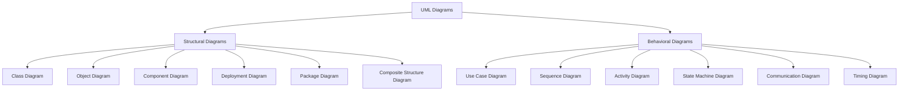

- **Structural Diagrams** — describe the static architecture of a system (classes, objects, components, how they are organized).
- **Behavioral Diagrams** — describe the dynamic behavior of a system (how objects interact over time, how processes flow).

---

## 4. Class Diagram Basics

The **Class Diagram** is the most commonly used UML diagram. It represents the classes in a system, their attributes, methods, and the relationships between them.

### Anatomy of a Class Box

A class is drawn as a rectangle divided into three compartments:

```
┌─────────────────────────────┐
│         ClassName            │   ← Class Name
├─────────────────────────────┤
│ - attribute1: Type           │   ← Attributes (fields)
│ + attribute2: Type           │
├─────────────────────────────┤
│ + method1(param: Type): Type │   ← Methods (operations)
│ - method2(): void             │
└─────────────────────────────┘
```

**Example — `Employee` class:**

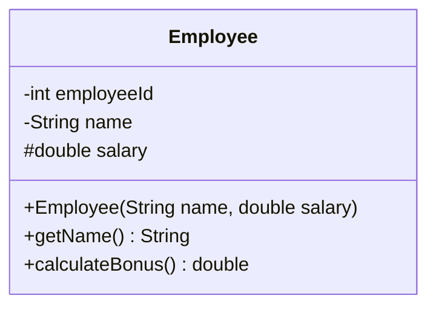

Equivalent Java:

```java
public class Employee {
    private int employeeId;
    private String name;
    protected double salary;

    public Employee(String name, double salary) {
        this.name = name;
        this.salary = salary;
    }

    public String getName() {
        return name;
    }

    public double calculateBonus() {
        return salary * 0.10;
    }
}
```

---

## 5. Relationships in UML (Core Concepts)

Relationships describe **how classes are connected to one another**. This is the part of UML that confuses most beginners — especially the difference between **association, aggregation, and composition**. Below, each is defined precisely with notation and Java code.

### 5.1 Association

> **Definition:** A general **structural relationship** between two classes that are connected, but each can exist independently of the other. It represents "uses-a" or "has-a-reference-to" relationship.

- **Notation:** A plain solid line, optionally with arrowheads to show direction and multiplicity labels at each end.
- **Lifecycle:** Both objects have independent lifecycles.

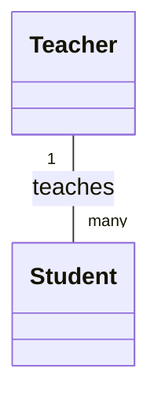

**Java Example:**
```java
public class Teacher {
    private String name;
    // Teacher knows about Students, but doesn't own their lifecycle
    public void teach(Student student) {
        System.out.println(name + " is teaching " + student.getName());
    }
}

public class Student {
    private String name;
    public String getName() { return name; }
}
```
A `Teacher` teaches a `Student`, but a `Student` can exist without a `Teacher` and vice versa — they are simply *associated*.

---

### 5.2 Aggregation

> **Definition:** A **special, weaker form of association** representing a "whole-part" or "has-a" relationship, where the part **can exist independently** of the whole. It's often called a "shared" relationship.

- **Notation:** A solid line with an **unfilled (hollow) diamond** at the "whole" end.
- **Lifecycle:** The part can outlive the whole (independent lifecycle).

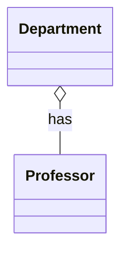

**Java Example:**
```java
public class Professor {
    private String name;
    public Professor(String name) { this.name = name; }
}

public class Department {
    private List<Professor> professors; // Professors can exist without Department

    public Department(List<Professor> professors) {
        this.professors = professors; // passed in — not created/owned internally
    }
}
```
If the `Department` is deleted, the `Professor` objects still exist — perhaps they move to another department. This independent survivability is the hallmark of aggregation.

---

### 5.3 Composition

> **Definition:** A **stronger form of aggregation**, representing an exclusive "whole-part" relationship where the part **cannot exist without the whole**. It implies ownership and a shared lifecycle.

- **Notation:** A solid line with a **filled (solid black) diamond** at the "whole" end.
- **Lifecycle:** When the whole is destroyed, its parts are destroyed too.

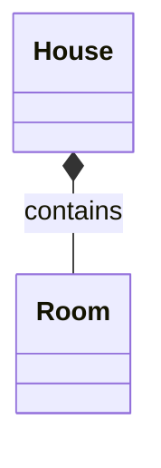

**Java Example:**
```java
public class Room {
    private String name;
    public Room(String name) { this.name = name; }
}

public class House {
    // Room objects are created and destroyed with the House itself
    private final List<Room> rooms = new ArrayList<>();

    public House() {
        rooms.add(new Room("Living Room")); // House owns creation of Rooms
        rooms.add(new Room("Bedroom"));
    }
    // When a House object is garbage collected, its Rooms go with it
}
```
A `Room` cannot logically exist outside of a `House` — it is created and destroyed together with it.

> **Quick memory trick:**
> - **Association** → "uses" (loosest coupling)
> - **Aggregation** → "has-a," parts survive (hollow diamond ◇)
> - **Composition** → "owns-a," parts die with the whole (filled diamond ◆)

---

### 5.4 Inheritance (Generalization)

> **Definition:** Represents an **"is-a"** relationship where a subclass (child) inherits attributes and behavior from a superclass (parent). It supports abstraction and code reuse.

- **Notation:** A solid line with a **hollow (unfilled) triangle arrowhead** pointing to the parent class.

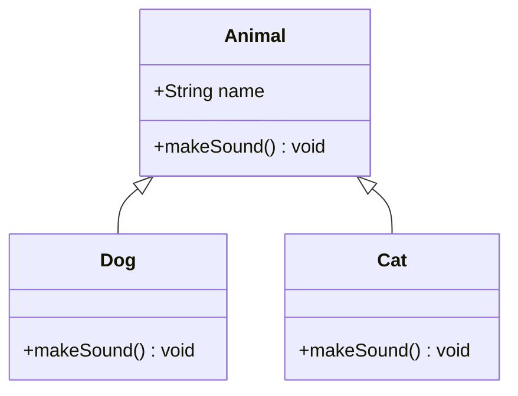

**Java Example:**
```java
public class Animal {
    protected String name;
    public void makeSound() {
        System.out.println("Some generic animal sound");
    }
}

public class Dog extends Animal {
    @Override
    public void makeSound() {
        System.out.println("Woof!");
    }
}
```

---

### 5.5 Realization (Implementation)

> **Definition:** A relationship between a class and an **interface**, where the class implements the behavior declared by the interface. This is an **"implements"** relationship.

- **Notation:** A **dashed line** with a **hollow triangle arrowhead** pointing to the interface.

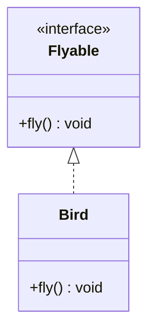

**Java Example:**
```java
public interface Flyable {
    void fly();
}

public class Bird implements Flyable {
    @Override
    public void fly() {
        System.out.println("Bird is flying");
    }
}
```

---

### 5.6 Dependency

> **Definition:** A **weaker, temporary relationship** where one class *uses* another class briefly — typically as a method parameter, local variable, or return type — without holding a long-term reference to it.

- **Notation:** A **dashed line with an open arrowhead**, pointing to the class being depended on.

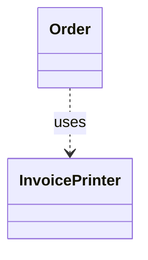

**Java Example:**
```java
public class InvoicePrinter {
    public void print(Order order) {
        System.out.println("Printing invoice for order: " + order.getId());
    }
}

public class Order {
    private String id;
    public String getId() { return id; }

    public void generateInvoice(InvoicePrinter printer) {
        printer.print(this); // Order depends on InvoicePrinter only within this method
    }
}
```

---

### 5.7 Multiplicity

> **Definition:** Multiplicity specifies **how many instances** of one class relate to instances of another class in an association.

| Notation | Meaning |
|---|---|
| `1` | Exactly one |
| `0..1` | Zero or one |
| `0..*` or `*` | Zero or many |
| `1..*` | One or many |
| `n` | Exactly n |
| `m..n` | Between m and n |

**Example:** `Teacher "1" -- "0..*" Student` means one Teacher is associated with zero or many Students.

---

## 6. Comparison Table: Relationships

| Relationship | Notation | Strength | "Has-a" / "Is-a" | Lifecycle Dependency | Example |
|---|---|---|---|---|---|
| **Association** | Solid line — | Weakest structural link | Uses-a | Independent | `Teacher — Student` |
| **Aggregation** | Solid line + hollow diamond ◇ | Weak "whole-part" | Has-a (shared) | Part survives without whole | `Department ◇— Professor` |
| **Composition** | Solid line + filled diamond ◆ | Strong "whole-part" | Owns-a (exclusive) | Part dies with whole | `House ◆— Room` |
| **Inheritance** | Solid line + hollow triangle △ | Structural (class-level) | Is-a | Subclass depends on superclass definition | `Dog ▷— Animal` |
| **Realization** | Dashed line + hollow triangle △ | Contractual | Implements | Class depends on interface contract | `Bird ┄▷ Flyable` |
| **Dependency** | Dashed line + open arrow → | Weakest, temporary | Uses (briefly) | No stored reference; transient use | `Order ┄→ InvoicePrinter` |

---

## 7. Behavioral Diagrams

Behavioral diagrams capture **how the system behaves over time** — not just its static shape.

### 7.1 Use Case Diagram

> **Definition:** Shows the functional requirements of a system from the user's (actor's) perspective — *what* the system does, not *how*.

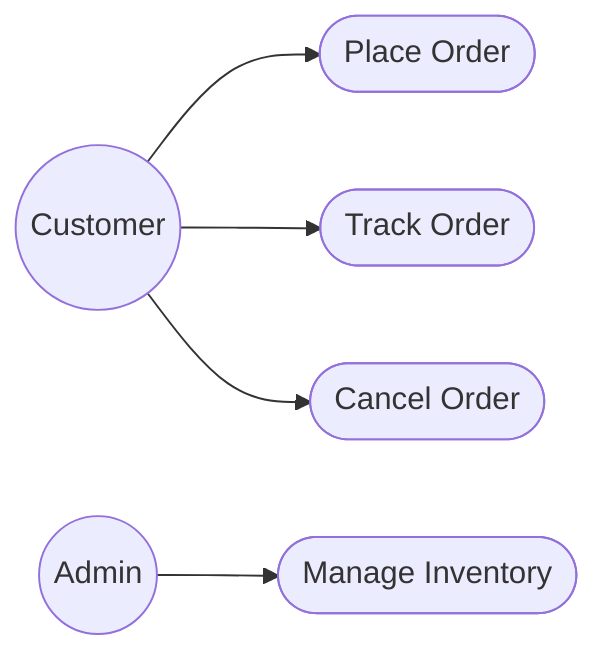

**Key terms:**
- **Actor** — a user or external system interacting with the system (stick figure).
- **Use Case** — an oval representing a discrete piece of functionality.
- **Include** — a use case always incorporates the behavior of another (`<<include>>`).
- **Extend** — a use case optionally extends another under certain conditions (`<<extend>>`).

---

### 7.2 Sequence Diagram

> **Definition:** Shows how objects **interact in a time-ordered sequence** — which object calls which method, and in what order.

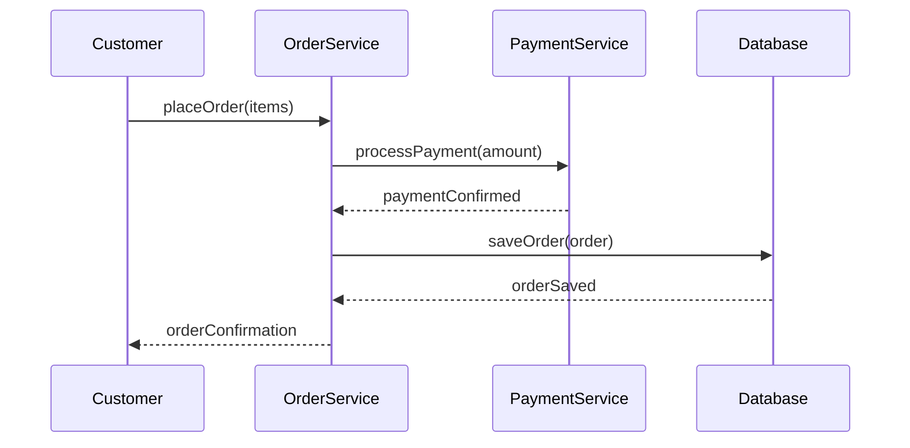

**Java mapping of the above:**
```java
public class OrderService {
    private PaymentService paymentService;
    private OrderRepository database;

    public String placeOrder(List<Item> items) {
        boolean paid = paymentService.processPayment(calculateTotal(items));
        if (paid) {
            Order order = new Order(items);
            database.saveOrder(order);
            return "Order Confirmed";
        }
        return "Payment Failed";
    }
}
```

---

### 7.3 Activity Diagram

> **Definition:** Similar to a flowchart — models the **workflow of a business process or algorithm**, including decisions, parallel actions, and loops.

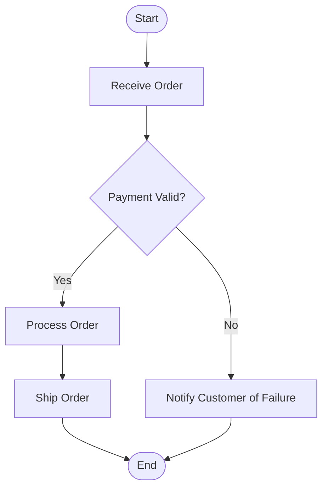

---

### 7.4 State Machine Diagram

> **Definition:** Models the different **states** an object can be in over its lifetime, and the events/transitions that move it between states.

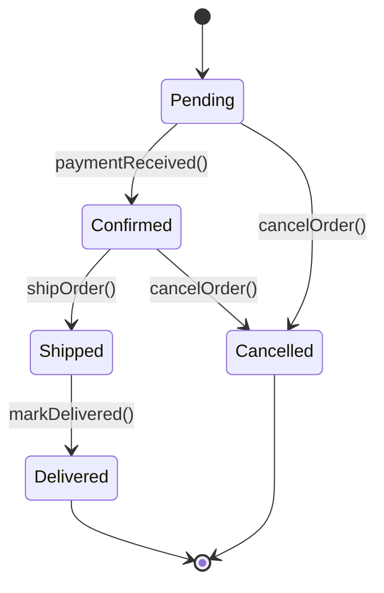

This maps naturally to a Java `enum`-driven state machine:
```java
public enum OrderState {
    PENDING, CONFIRMED, SHIPPED, DELIVERED, CANCELLED
}
```

---

## 8. Advanced Structural Diagrams

### 8.1 Component Diagram

> **Definition:** Shows how a system is broken into **interchangeable components** (modules, libraries, services) and the interfaces they expose or consume. Common in microservices and modular architecture.

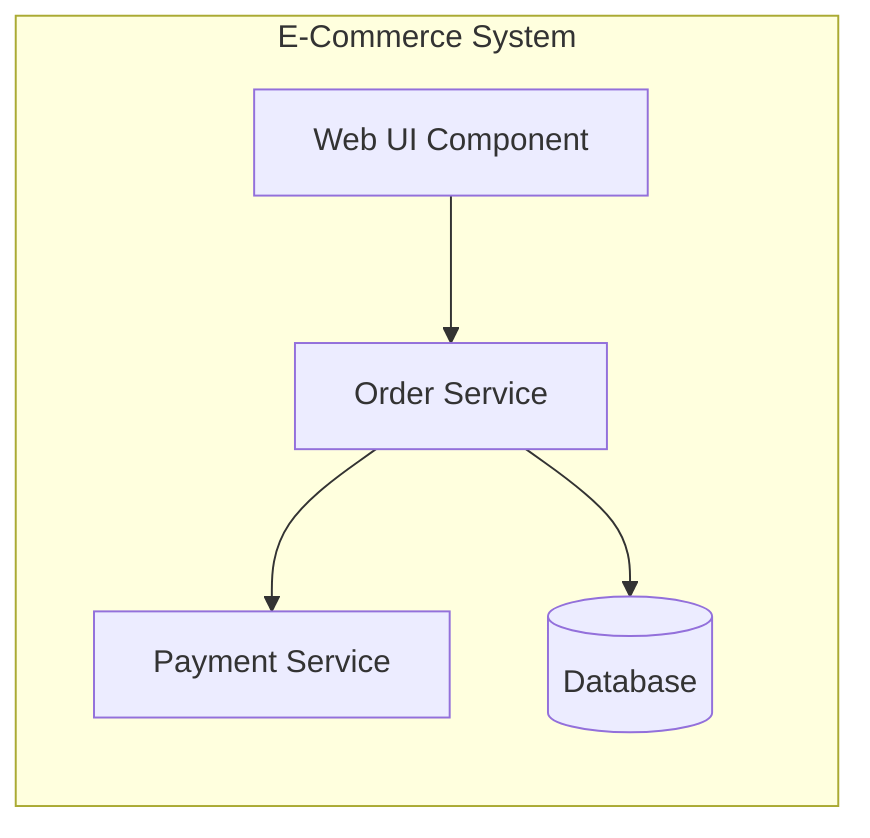

### 8.2 Deployment Diagram

> **Definition:** Shows the **physical architecture** of a system — hardware nodes (servers, devices) and how software artifacts are deployed onto them.

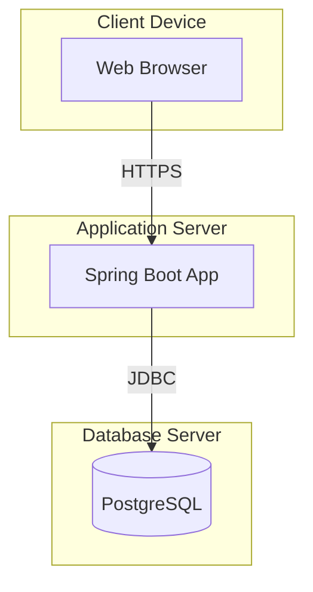

### 8.3 Package Diagram

> **Definition:** Groups related classes/interfaces into **packages** (namespaces) and shows dependencies between them — analogous to Java packages, C# namespaces, or Python modules.

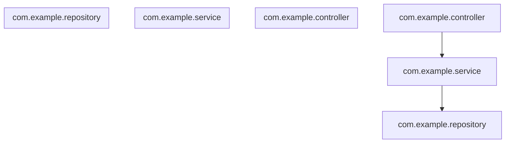

### 8.4 Object Diagram

> **Definition:** A **snapshot** of instances (objects) and their links at a specific point in time — essentially a class diagram populated with real data.

```mermaid
classDiagram
    class john "john:Employee" {
        name = "John Doe"
        salary = 55000
    }
    class hr "hr:Department" {
        name = "Human Resources"
    }
    hr --> john
```

---

## 9. Visibility & Access Modifiers Notation

UML uses symbols to represent visibility, which map directly to Java access modifiers:

| UML Symbol | Meaning | Java Equivalent |
|---|---|---|
| `+` | Public | `public` |
| `-` | Private | `private` |
| `#` | Protected | `protected` |
| `~` | Package/default | *(no modifier)* |
| `/` prefix | Derived attribute | *(computed, e.g. getter-based)* |
| *underline* | Static member | `static` |
| *italics* | Abstract member/class | `abstract` |

---

## 10. Full Worked Example: Java + UML Class Diagram

Consider a simple **Library Management System**. Here's the full UML class diagram, followed by matching Java code.

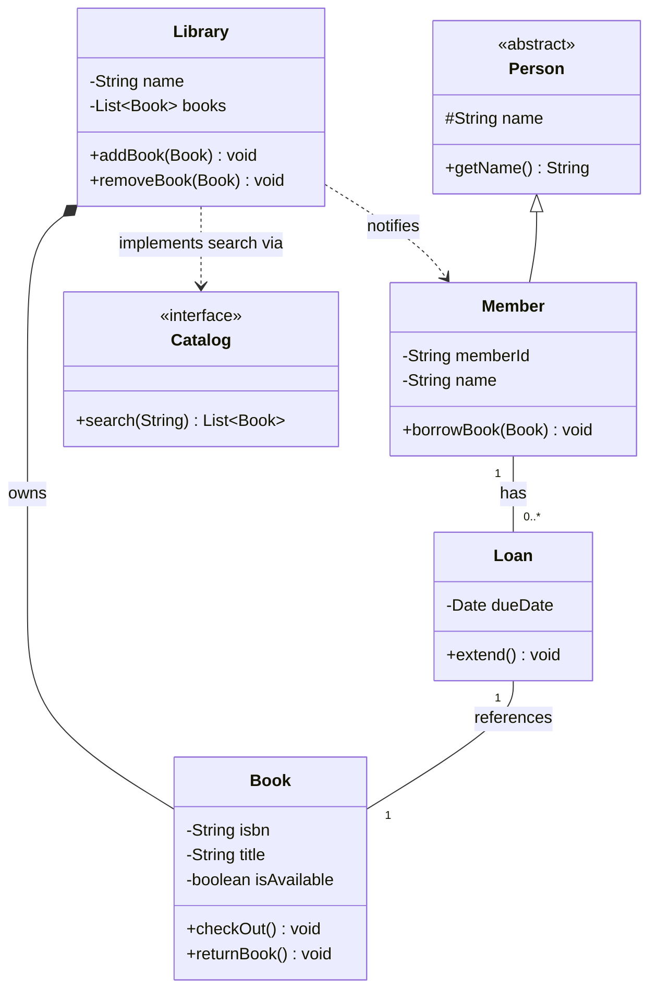

**Java Implementation:**

```java
// --- Abstraction (Inheritance base) ---
public abstract class Person {
    protected String name;
    public String getName() { return name; }
}

// --- Interface (Realization) ---
public interface Catalog {
    List<Book> search(String keyword);
}

// --- Composition: Book cannot exist outside Library's ownership context ---
public class Book {
    private String isbn;
    private String title;
    private boolean isAvailable = true;

    public Book(String isbn, String title) {
        this.isbn = isbn;
        this.title = title;
    }

    public void checkOut() { isAvailable = false; }
    public void returnBook() { isAvailable = true; }
}

// --- Inheritance ("is-a") ---
public class Member extends Person {
    private String memberId;

    public void borrowBook(Book book, Library library) {
        library.lendBook(book, this); // Dependency: temporary use of Library
    }
}

// --- Association: Loan links a Member and a Book ---
public class Loan {
    private Member member;
    private Book book;
    private Date dueDate;

    public Loan(Member member, Book book, Date dueDate) {
        this.member = member;
        this.book = book;
        this.dueDate = dueDate;
    }

    public void extend() {
        // extend dueDate logic
    }
}

// --- Realization: Library implements Catalog interface ---
public class Library implements Catalog {
    private String name;
    private List<Book> books = new ArrayList<>(); // Composition

    public void addBook(Book book) {
        books.add(book);
    }

    public void removeBook(Book book) {
        books.remove(book);
    }

    public void lendBook(Book book, Member member) {
        book.checkOut();
        new Loan(member, book, new Date());
    }

    @Override
    public List<Book> search(String keyword) {
        return books.stream()
            .filter(b -> b.getTitle().contains(keyword))
            .collect(Collectors.toList());
    }
}
```

**Relationship mapping recap for this example:**
- `Library *-- Book` → **Composition** (Books belong exclusively to the Library's collection lifecycle)
- `Member -- Loan` → **Association** with multiplicity (a Member can have many Loans)
- `Person <|-- Member` → **Inheritance**
- `Library ..> Catalog` → **Realization** (implements interface)
- `Member ..> Library` (via `borrowBook`) → **Dependency**

---

## 11. UML Across Other Languages

UML is intentionally **language-agnostic**. The diagrams above translate almost 1:1 into other OOP languages. Here's how the same core relationships look:

| Concept | Java | C# | Python | C++ |
|---|---|---|---|---|
| **Inheritance** | `class Dog extends Animal` | `class Dog : Animal` | `class Dog(Animal):` | `class Dog : public Animal {}` |
| **Realization** | `class Bird implements Flyable` | `class Bird : IFlyable` | `class Bird(Flyable):` (via ABC) | `class Bird : public Flyable {}` (pure virtual) |
| **Composition** | Field initialized internally, `final List<Room> rooms = new ArrayList<>()` | `private readonly List<Room> rooms = new();` | `self.rooms = [Room() for _ in range(n)]` | Member object (not pointer): `Room room;` |
| **Aggregation** | Field passed via constructor, stored by reference | Constructor-injected reference | Object passed in `__init__`, stored as attribute | Member is a pointer/reference: `Room* room;` |
| **Association** | Method parameter referencing another class | Same | Same | Same |
| **Dependency** | Local variable / method parameter | Same | Same | Same |
| **Interface** | `interface` keyword | `interface` keyword (prefixed `I`) | Abstract Base Class (`abc.ABC`) | Abstract class with pure virtual functions |

> **Key takeaway:** Regardless of language syntax, the UML diagram itself doesn't change. A composition relationship is drawn identically whether the underlying code is Java, Python, or C++ — UML models the *design*, not the *syntax*.

---

## 12. Advanced Concepts

### Abstract Classes vs Interfaces in UML
- **Abstract class** → class name shown in *italics*, may have both implemented and unimplemented methods.
- **Interface** → marked with `<<interface>>` stereotype, all methods implicitly abstract (pre-Java 8; Java 8+ allows default methods, but the UML notion of "contract" still applies).

### Stereotypes
> **Definition:** Stereotypes extend UML's vocabulary by labeling model elements with additional semantic meaning, written as `<<stereotype>>`.

Common stereotypes: `<<interface>>`, `<<abstract>>`, `<<enumeration>>`, `<<entity>>`, `<<controller>>`, `<<service>>`, `<<boundary>>`.

### Composite Structure Diagram
Used to show the **internal structure** of a class and its collaborations with other structures at runtime — useful for complex components with internal parts.

### Interaction Overview Diagram
A hybrid of the Activity Diagram and Sequence Diagram — shows the control flow between multiple smaller sequence diagrams.

### Timing Diagram
Shows the **state changes of objects over a precise timeline**, common in embedded/real-time systems.

### Design Patterns & UML
Most classic design patterns (Gang of Four) are typically expressed as UML class diagrams. For example, the **Observer Pattern**:

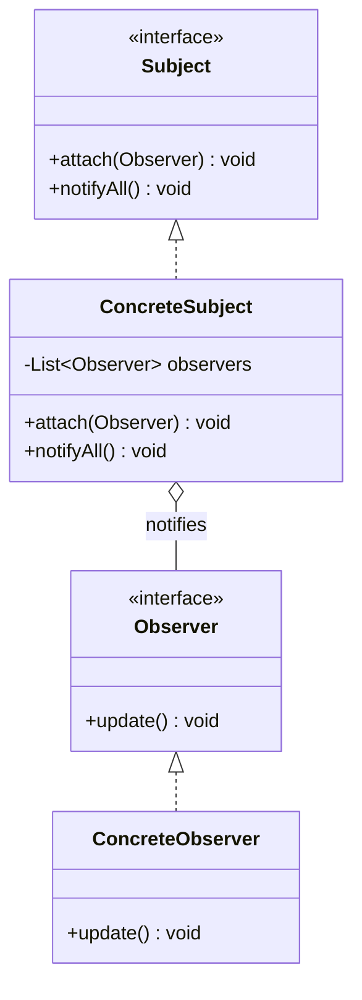

---

## 13. Best Practices

1. **Don't over-model.** Only diagram what adds clarity — UML is a communication tool, not an end in itself.
2. **Keep diagrams focused.** One diagram per concern (e.g., one class diagram for the ordering subsystem, not the whole system).
3. **Use consistent notation.** Stick to standard OMG notation so diagrams are portable across tools and readers.
4. **Prefer composition over inheritance** in your actual design (a well-known OOP principle) — and let your UML diagrams reflect that choice deliberately.
5. **Update diagrams with code.** Outdated UML diagrams are worse than no diagrams — treat them as living documentation.
6. **Combine diagram types.** Use class diagrams for structure and sequence/activity diagrams for behavior — together they tell the full story.

---

## 14. Quick Reference Cheat Sheet

| Symbol | Diagram Element |
|---|---|
| `——————` | Association |
| `◇———` | Aggregation |
| `◆———` | Composition |
| `———▷` (hollow triangle, solid line) | Inheritance / Generalization |
| `┄┄┄▷` (hollow triangle, dashed line) | Realization / Implementation |
| `┄┄┄→` (open arrow, dashed line) | Dependency |
| `+` | Public |
| `-` | Private |
| `#` | Protected |
| `~` | Package-private |
| `<<interface>>` | Interface stereotype |
| *Italic text* | Abstract class/method |
| Underlined text | Static member |

---

### Summary

UML gives you a **shared visual vocabulary** to describe software systems — from the static shape of classes and their relationships (association, aggregation, composition, inheritance, realization, dependency) to the dynamic behavior of workflows, state transitions, and object interactions. While the syntax of implementation differs across Java, Python, C#, or C++, the **UML model itself remains constant** — making it one of the most durable and universal tools in a software engineer's toolkit.

